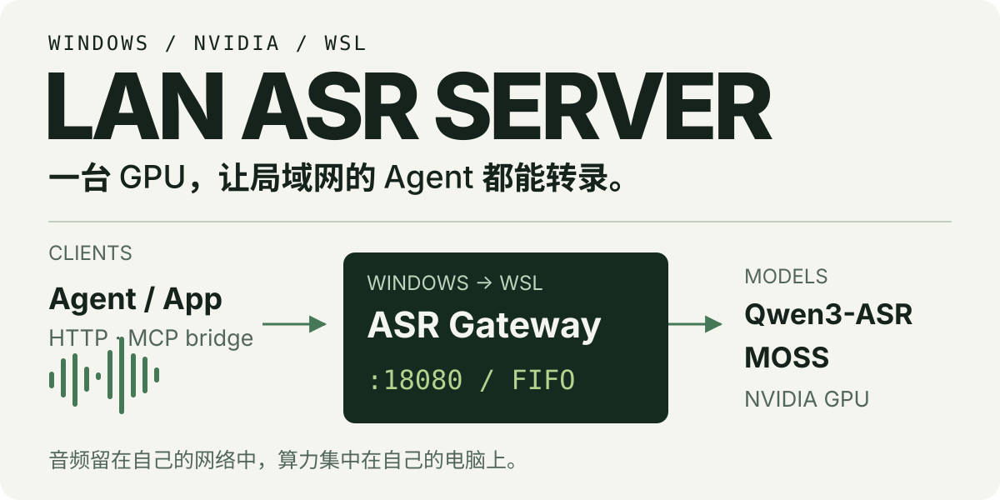

<p align="center">
  
</p>

# LAN ASR Server

**把一台 Windows + NVIDIA + WSL 电脑，变成局域网里所有 Agent 共用的语音转录服务器。**

模型和 GPU 留在 Windows 电脑的 WSL 中。其他电脑上的 Agent、脚本和应用通过 HTTP 上传音频，拿回文字、时间信息或播客说话人分段；支持 MCP 的 Agent 可以通过本地 bridge 调用同一套服务。

[开始部署](#开始部署) · [接入 Agent](#接入-agent) · [转录播客](#用-moss-转录播客) · [能力与边界](#能力与边界) · [完整文档](docs/README.md)

## 局域网转录工作台（新增）

网页与 API 共用 `18080`，提供个人账号、音视频断点上传、任务恢复、回听改字和 TXT/SRT/VTT/JSON 导出。工作台数据在本地服务器保存，任务结束后保留 7 天。

```bash
uv sync
npm --prefix frontend ci
npm --prefix frontend run build
uv run python -m scripts.workbench_admin create admin
# 无 GPU 开发预览；真实部署按 WSL 指南设置 adapter 和 alignment gate
ASR_ADAPTER=mock ASR_ENABLE_QWEN_ALIGNMENT=1 uv run uvicorn asr_server.main:app --host 0.0.0.0 --port 18080
```

打开 `http://YOUR_WINDOWS_LAN_IP:18080/`；开发机打开 `http://127.0.0.1:18080/`。密码由管理员交互创建，没有默认账号密码。生产只需构建后的静态文件，无需常驻 Node 服务。

工作台使用新的 `quality_v1` 候选流程：完整覆盖切分、词库快照、局部复核、真实字词对齐；**尚需真实长音频与人工参考文本验证，不宣称六小时质量已达标**。旧 `/v1/**` 默认 `legacy`，原有客户端无需更改。

详见 [工作台契约](docs/product-workbench.md) 和 [质量评测](evaluation/README.md)。

## 转录之后，Agent 拿到什么

普通转录返回正文；启用 Qwen 对齐后可以回看字/词时间；MOSS 返回带段级时间和匿名说话人标签的播客文本。批量工具把结果落成可交接的文件夹：

```text
output/
├── index.md                         # Agent 先读这份索引
├── manifest.json                    # 每条素材的状态与来源
└── items/<素材ID-内容hash>/
    ├── transcript.md                # 人和 Agent 都能直接阅读
    └── transcript.json              # 文字、时间、说话人与诊断信息
```

查看[完整输出样例](examples/output-sample/index.md)及其[结构化 JSON](examples/output-sample/items/sample-oral-001-deadbeef0001/transcript.json)。这些文件是明确标记的合成示例；真实模型验证见 [Qwen / MOSS 验收记录](docs/validation-2026-09-19-upgrade.md)。

## 两种模型，一套入口

| 你要做什么 | 模型 | 结果 |
| --- | --- | --- |
| 日常语音、视频口播转录 | Qwen3-ASR 1.7B（默认） | 正文、多语言识别、Context / 关键词提示 |
| 轻量转录、首次 GPU 验收 | Qwen3-ASR 0.6B | 同一套转录接口，更小的模型尺寸 |
| 回看口播时间、分析停顿 | Qwen + 官方 ForcedAligner | 真实字/词时间；需单独验收并启用对齐 |
| 多人播客、访谈 | MOSS-Transcribe-Diarize | 段级时间、匿名说话人、长音频分块；需单独验收并启用 MOSS |

Qwen 模型 ID 为 `qwen3-asr-1.7b` / `qwen3-asr-0.6b`；MOSS 为 `moss-transcribe-diarize-0.9b`。当前真实后端为 Hugging Face `transformers`。

**Agent 每次接入应先读 `GET /v1/models`。** 运行时返回值决定当前机器可用的模型、后端和能力；安装了代码不代表已启用 MOSS 或对齐。

## 怎么工作

```text
局域网 Agent / 应用 / 脚本
         │ HTTP 上传音频（或本地 stdio MCP bridge）
         ▼
Windows → WSL ASR Gateway :18080
         │ 能力发现 · 异步 FIFO 队列 · 模型加载 / 卸载
         ▼
Qwen3-ASR / MOSS → NVIDIA GPU → 转录结果
```

多个 Agent 可以排队提交任务。服务同一时间执行一个真实转录 job，报告服务端阶段和已完成 chunk 的进度。模型按需加载，默认空闲 180 秒后卸载；卸载会等待正在执行的请求结束。上传与中间音频在任务完成、失败或取消后清理。

## 开始部署

服务器需要 **Windows 11 22H2+、NVIDIA 显卡、WSL2**，并配置 mirrored networking 和 systemd。局域网只开放 TCP `18080`。Windows 驱动、WSL 网络和防火墙的操作见[部署指南](docs/wsl-deployment.md)。

已实机验证的组合是 **WSL2 Arch Linux + RTX 5070 Ti 16GB**。其他 NVIDIA 显卡需要匹配的 CUDA wheel 并通过 GPU smoke；Ubuntu 的系统依赖命令提供在指南中，尚无本项目的对应实机验收记录。

在 **WSL 内**安装好 [uv](https://docs.astral.sh/uv/getting-started/installation/)，把仓库放在 Linux 文件系统：

```bash
mkdir -p ~/services
git clone https://github.com/JinghaoHCDS/asr_Server.git ~/services/asr-server
cd ~/services/asr-server

bash deploy/wsl-deploy.sh --smoke-audio test-fixtures/audio/test_short.wav
```

部署脚本负责 Python 3.12 环境、官方 CUDA wheel 依赖、CUDA 检查、Qwen 独立转录验收和 systemd user service。首次运行需要下载依赖与模型；默认服务允许按需下载尚未缓存的模型。需要离线运行时，先把要用的每个模型验收并缓存，再选择离线模式。

部署后在 WSL 检查：

```bash
curl --noproxy '*' -fsS http://127.0.0.1:18080/health
curl --noproxy '*' -fsS http://127.0.0.1:18080/v1/models
```

在另一台局域网电脑，把地址换成 **Windows 主机的局域网 IP**：

```bash
ASR_URL="http://YOUR_WINDOWS_LAN_IP:18080"
curl --noproxy '*' -fsS "$ASR_URL/health"
curl --noproxy '*' -fsS "$ASR_URL/v1/models"

curl --noproxy '*' -fsS "$ASR_URL/v1/audio/transcriptions" \
  -F 'file=@audio.wav' \
  -F 'language=auto'
```

返回非空 `text` 即完成第一条转录。较长音频可能返回 `202` 异步 job；长素材建议直接创建 job。交互式 API 文档位于 `http://YOUR_WINDOWS_LAN_IP:18080/docs`。

## 用 MOSS 转录播客

先在 WSL 完成独立 MOSS 验收，并确认 CUDA torch 仍可用：

```bash
uv run python scripts/moss_backend_smoke.py \
  --model OpenMOSS-Team/MOSS-Transcribe-Diarize \
  --audio test-fixtures/audio/test_short.wav \
  --language auto
```

验收通过后，在服务器项目的 `.env` 中设置 `ASR_ENABLE_MOSS=1`，等待活跃任务结束，再执行 `systemctl --user restart asr-server.service`。确认 `/v1/models` 出现 MOSS 后提交播客：

```bash
curl --noproxy '*' -fsS "$ASR_URL/v1/audio/transcription-jobs" \
  -F 'file=@podcast.m4a' \
  -F 'model=moss-transcribe-diarize-0.9b' \
  -F 'purpose=podcast'

# 将 JOB_ID 换成创建响应的 id 字段
curl --noproxy '*' -fsS "$ASR_URL/v1/jobs/JOB_ID?detail=compact"
# 任务 completed 后，取一次完整结果
curl --noproxy '*' -fsS "$ASR_URL/v1/jobs/JOB_ID?detail=full"
```

`result.text` 是最终正文；`result.segments` 包含发言片段。`purpose=podcast` 启用适合播客的参数和 Anchor Replay。只在返回的 `speaker_scope=global` 时把标签视为本期一致；`mixed` / unresolved 片段保留为未知。标签是本次任务内的匿名编号，不是人物姓名。

## 接入 Agent

### HTTP：任何能发请求的应用

先发现模型，再按需上传、轮询和获取结果：

| 操作 | API |
| --- | --- |
| 健康与能力发现 | `GET /health`、`GET /v1/models` |
| 短音频转录 | `POST /v1/audio/transcriptions` |
| 长音频提交 | `POST /v1/audio/transcription-jobs` |
| 状态 / 完整结果 | `GET /v1/jobs/{id}?detail=compact\|full` |
| 请求取消 | `DELETE /v1/jobs/{id}` |
| 模型管理 | `POST /v1/models/{id}/load`、`DELETE /v1/models/{id}` |

API 合约、错误信封和取消语义见 [PRD](docs/asr-server-prd.md)。服务使用自己的 `/v1/models` 与 job 协议，客户端应按本项目合约对接。

### MCP：给支持 MCP 的 Agent 八个工具

在 **Agent 所在电脑**安装轻量客户端依赖：

```bash
uv sync --extra mcp
```

把下面配置放入 MCP Host，替换仓库路径、Windows IP 和允许读取音频的目录：

```json
{
  "mcpServers": {
    "lan-asr": {
      "command": "uv",
      "args": [
        "run", "--directory", "/path/to/asr_Server",
        "--extra", "mcp", "python", "-m", "asr_mcp.server"
      ],
      "env": {
        "ASR_MCP_BASE_URL": "http://YOUR_WINDOWS_LAN_IP:18080",
        "ASR_MCP_ALLOWED_ROOTS": "/path/to/audio"
      }
    }
  }
}
```

Agent 可发现模型、查询状态、转录文件、创建 / 查询 / 取消 job、加载 / 卸载模型。bridge 通过 stdio 工作，模型仍在 WSL；无需给客户端安装 torch 或下载模型。MCP 已验证 Mac 客户端，Windows / Linux bridge 尚待实机验收；原生 Windows 路径写成 JSON 字符串时需转义反斜杠。完整配置见 [MCP 指南](docs/mcp-bridge.md)。

### CLI 与批量交接

CLI 会先发现能力，为播客选择可用的说话人模型：

```bash
uv run python scripts/asr_client.py --base-url "$ASR_URL" \
  job /path/to/podcast.m4a --purpose podcast --poll-seconds 30

uv run python scripts/batch_transcribe.py batch.json \
  --output output --base-url "$ASR_URL" --max-in-flight 4
```

批量清单支持逐素材 Context / 关键词、本地缓存、恢复和原子落盘。清单格式、Qwen 口播对齐与完整命令见[批量工作流](docs/batch-workflow.md)。

## 配置

复制 [.env.example](.env.example) 为服务器的 `.env` 后按需调整。部署生成的 systemd unit 会读取它；直接运行 Python / Uvicorn 时不会自动加载，需用环境变量或 `--env-file .env`。MCP 变量由 Host 的 `env` 传入。

| 配置 | 默认 / 用途 |
| --- | --- |
| `ASR_ADAPTER` | 代码默认 `mock`；真实部署脚本设置 `qwen` |
| `ASR_ENABLE_MOSS` | `0`；独立 GPU smoke 后启用播客模型 |
| `ASR_ENABLE_QWEN_ALIGNMENT` | `0`；官方 aligner smoke 后启用真实时间戳 |
| `ASR_API_TOKEN` | 未设置；设置后 `/v1/**` 需要 Bearer Token |
| `ASR_IDLE_UNLOAD_SECONDS` | `180`；模型空闲卸载等待时间 |
| `ASR_MAX_QUEUED_JOBS` | `20`；排队任务上限 |
| `ASR_MAX_UPLOAD_MB` | `512`；单文件上传上限 |
| `ASR_JOB_RESULT_TTL_SECONDS` | `3600`；内存任务结果保留时间 |

启用 Token 后，HTTP 请求携带 `Authorization: Bearer <token>`；CLI / batch 使用 `ASR_TOKEN`，MCP 使用 `ASR_MCP_TOKEN`。`/health` 和文档保持可访问；Swagger 中可用 **Authorize** 输入 Token。

## 能力与边界

- **播客长度与说话人**：30 分钟原生推理已有真实记录，更长素材自动分块。Anchor Replay 最多尝试维护 4 位匿名说话人；真实长播客仍可能返回 partial / mixed。4–5 小时整期说话人一致性尚未通过完整素材验收。
- **时间戳**：Qwen 的字/词时间来自官方 ForcedAligner；MOSS 提供段级时间。细粒度对齐使用转录请求参数，独立 `/v1/audio/alignments` 仍为预留接口。
- **恢复**：服务器 job 和幂等记录在内存，重启会丢失；批量客户端保存已完成结果，并可重新提交丢失任务。服务端不承诺断点续算。
- **运行方式**：单机、单 GPU 调度；当前无 vLLM、实时 streaming、Web 管理后台或分布式任务队列。
- **网络**：用于局域网，只开放 `18080`，不设置公网隧道或公网端口映射。

历史验收证明的是对应版本和素材。完整的成功结果、未通过项与限制见[验收记录索引](docs/README.md#验收记录)。

## 开发与维护

无 GPU 环境可运行 mock API 和测试。需要系统 `ffmpeg` / `ffprobe`，Python 环境由 uv 管理：

```bash
uv sync --locked
uv run --locked pytest -q
uv run --locked mypy asr_server asr_mcp tests scripts
ASR_ADAPTER=mock uv run uvicorn asr_server.main:app --host 127.0.0.1 --port 18080
```

真实 CUDA、模型安装与 GPU 转录在 WSL 完成。开发约定见 [AGENTS.md](AGENTS.md)，仓库整理说明见[清理记录](docs/repository-cleanup.md)。模型权重与第三方依赖按各自许可证使用；本仓库尚未声明独立开源许可证。
